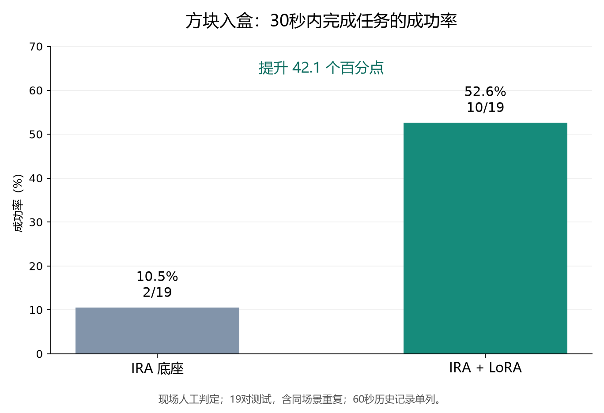

# π₀.₅ × SO-101：示范学习与真机方块入盒

基于 π₀.₅ 视觉—语言—动作模型，在 SO-101 上完成双视角示范采集、IRA 底座 LoRA 微调、云端 guided RTC 推理和真机配对评估。

## 主要结果

在统一 **30 秒时限**的 19 对真机试验中：

| 模型 | 成功次数 | 成功率 |
|---|---:|---:|
| IRA π₀.₅ 底座 | 2 / 19 | 10.5% |
| 同一底座 + 020000 LoRA | 10 / 19 | 52.6% |

**成功率提高 42.1 个百分点。** 两组使用相同任务处理器、统计量和 guided RTC 执行方式；结果来自现场人工标注，限于本次有限场景探索评估。



- 训练数据：50 段、11,580 帧，30 FPS；42 段训练、8 段留出。
- 训练：LoRA rank 16，约 129 万可训练参数；20,000 个循环约对应 5,000 次优化器更新。
- 正式评估：共 40 个计分回合；前一对为 60 秒，后续 19 对为 30 秒。以上主结果仅使用后者。
- 原实验保存了全部 40 份计分录像。本仓库包含计分记录、逐轮摘要和精选示例；全量录像、数据和模型不随仓库分发。
- 另有 4 次通信/时序中断，记录并重试，未计入任务成功率分母。LoRA 在 30 秒组仍有 9/19 次失败。

详见 [完整结果](results/blockbox-ab-formal-20261117/comparison.md) 和 [成果汇总](docs/project-results-20261117.md)。

## 视频示例

- [LoRA 成功示例（T03）](media/lora-success.mp4)
- [底座成功示例（T22）](media/base-success.mp4)
- [LIBERO 仿真案例](results/pi05-libero-success.mp4)

两段真机视频来自各自首个成功的 30 秒回合，场景不同，不能用于配对速度比较。来源与计时见 [examples.json](media/examples.json)，总体效果以完整评分记录为准。

## 项目结构

```text
scripts/       RTC 服务与客户端、评估面板、复位、采集和历史实验脚本
configs/       历史采集与训练配置
docs/          成果、实验、部署与诊断记录
results/       正式评估标注、统计、逐轮摘要和仿真示例
data/          数据集元信息（不含原始视频和逐帧数据）
media/         两段真机成功示例及来源
third_party/   实验使用的 LeRobot RTC 队列兼容快照及许可证
tools/         仓库检查与显式安装兼容快照的工具
```

## 检查与运行

无需机器人或机器学习依赖，可先检查代码语法、JSON 和结果统计：

```bash
python tools/check_repository.py
```

本项目是实验代码归档，尚未在全新环境完成一键复现。Windows 客户端与 Linux 云端训练环境不同；依赖版本、兼容快照、模型和校准准备见 [环境说明](docs/ENVIRONMENT.md)。

现有兼容环境中的无硬件回归检查：

```bash
python -m unittest discover -s scripts -p "test_blockbox*.py"
```

真机入口为 `scripts/run_blockbox_rtc.py`，评估入口为 `scripts/blockbox_ab_panel.py`。先配置检查点、SSH 隧道、双相机和本机校准；执行命令与单位约定见 [RTC 说明](docs/so101-block-box-rtc-20261117.md)。机械臂动作需显式执行选项及现场准备。默认读取保存观测的路径对应原实验数据，克隆仓库后需自行提供。

## 其他实验

- 药瓶任务：121 段、33,890 帧示范；本地确认 45,000 步检查点，没有标准化任务成功率，80,000 步仅为训练目标。
- OpenArm 拧盖：完成仿真数据适配、短程微调和闭环评估，500 步模型在三个留出位置为 0/3。仿真包含辅助机制，不能证明真实拧盖能力。

## 资料与分发范围

原项目根目录为 `E:\pi0.5`。历史记录中的绝对路径、检查点名和时间用于追溯；云服务器地址和 SSH 端口已替换为占位值。原始日志、凭据、个人校准、虚拟环境、模型权重、原始数据和大部分录像不上传。

模型和数据未随仓库授权或分发，需依据各自来源的条款获取。上游项目：[OpenPI](https://github.com/Physical-Intelligence/openpi)、[LeRobot](https://github.com/huggingface/lerobot)、[SO-ARM100 / SO-101](https://github.com/TheRobotStudio/SO-ARM100)。第三方快照保留其许可证；本仓库未另行指定项目代码许可证。
